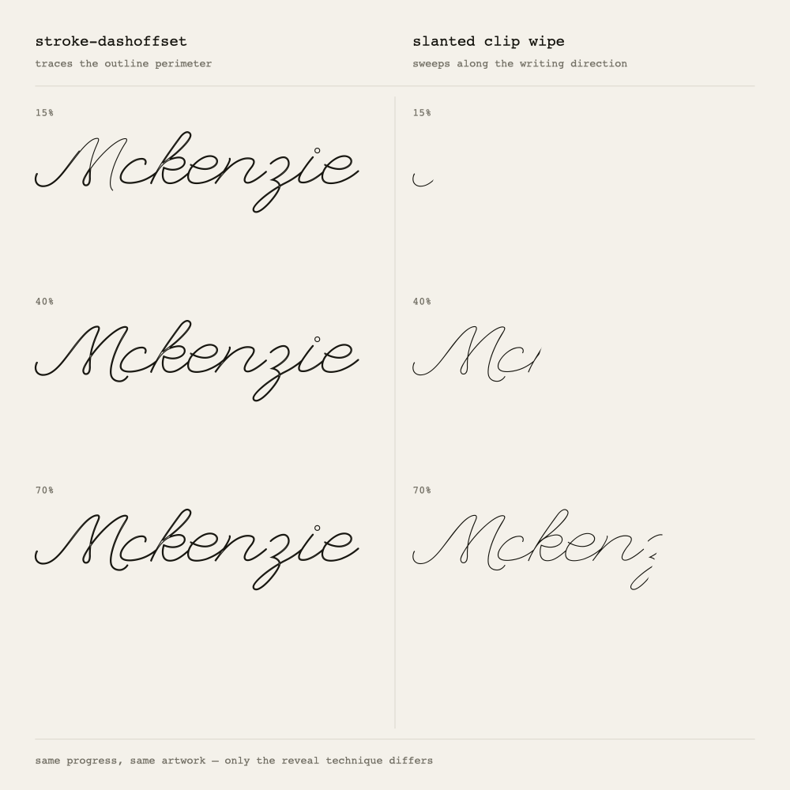

# Personal site

The portfolio of Richard Bright Asiedu-Bentum, built in the open.

Two things make this repo worth reading more than the finished site will be: it
is written test-first, and it is written with an AI assistant in a way that
leaves the reasoning visible. Both of those are easier to show than to claim,
so the notes below are about specific decisions and the evidence behind them,
including the ones that turned out to be wrong.

**Status:** early. There is an intro sequence and a deliberately blank home
page. The sections are not built, and the palette and type are still settling.
Nothing here is a placeholder left behind by a template — anything that stopped
earning its place has been deleted.

---

## Running it

```bash
pnpm install
pnpm dev          # http://localhost:3000
pnpm test         # vitest, once
pnpm test:watch
pnpm typecheck
pnpm lint
pnpm build
```

The intro plays once per browser session. To see it again, open a private
window or run `sessionStorage.clear()` and reload.

---

## Stack

| | |
|---|---|
| **Next.js (App Router)** | Static by default. The public page is mostly HTML, with animation isolated in small client components. |
| **TypeScript** | |
| **Tailwind v4** | Configured in CSS via `@theme`, so design tokens live next to the styles that use them rather than in a separate JS config. |
| **GSAP** + `@gsap/react` | `useGSAP()` ties animation cleanup to the component lifecycle. Without it, React Strict Mode's double mount leaves duplicate tweens and leaked ScrollTriggers. |
| **Lenis** | Smooth scrolling, driven from GSAP's ticker rather than its own loop. |
| **Vitest** + Testing Library | |

Six runtime dependencies. Three were removed once the code that justified them
was deleted.

---

## Decisions

### Writing a signature that could not be drawn

The intro writes the wordmark on. The obvious way to animate an SVG is
`stroke-dasharray` with an animated `stroke-dashoffset` — the standard "draw"
effect.

It does not work here, and the reason is a property of the artwork. The
signature is a **monoline script**: a single filled path tracing *both sides* of
one continuous pen stroke, with fourteen subpaths for eight letters. A dash
animation walks the path's **perimeter**, which runs along the top of the entire
connected word before returning along the bottom. The whole signature is legible
almost immediately, then slowly fills in behind itself. It unrolls like a ribbon
instead of being written.



The replacement is a clip swept along the writing direction. The edge is slanted
to match the script's own italic angle, so letters terminate on the pen angle
rather than being sliced vertically mid-stroke.

Both of these were settled by rendering frames to disk and looking at them, not
by reasoning about them. That cost about ten minutes and reversed the approach.

### The loader is a state machine, and that is not over-engineering

The intro's phases are advanced by GSAP completion callbacks arriving from
several timelines over roughly two seconds, plus a safety timeout, plus Strict
Mode invoking effects twice in development. That is a lot of ways for events to
arrive out of order, and the failure mode is the worst one available: a visitor
stranded behind a full-screen overlay with no way to dismiss it.

So [`machine.ts`](src/lib/loader/machine.ts) is a transition table. Illegal
moves are no-ops by construction rather than by remembering to guard them, and
`done` is terminal — once the page is visible, nothing may cover it again. A
timeout releases the page after six seconds whatever else has happened.

One test asserts that an ignored event returns the **same object reference**.
That is not a micro-optimisation: `useReducer` bails out of re-rendering when
the reference is unchanged, so stray callbacks cost nothing.

### Deciding before the first paint

Whether the intro plays depends on the reduced-motion preference and whether it
already ran this session. Both are only knowable on the client — but deciding in
an effect is too late, because effects run *after* the first paint. A repeat
visitor would see one frame of curtain; someone who asked for reduced motion
would see exactly the thing they asked not to see.

So a small blocking script in `<head>` decides and records the verdict as
attributes on `<html>`. CSS and React both read it. The catch-all is biased on
purpose: on any failure it marks the intro done. The page may lose its intro; it
can never be trapped behind one.

The same attribute gates every element that starts hidden for an animation,
which gives three correct outcomes from one mechanism — animation with no flash
of unstyled content, reduced motion, and JavaScript disabled or broken.

### One clock for scrolling

Lenis and GSAP's ScrollTrigger both want to own the scroll loop. Left alone they
desynchronise: Lenis animates scroll position on its own `requestAnimationFrame`
while ScrollTrigger samples on GSAP's ticker. Scroll-linked animations then trail
the visible scroll by a frame or two.

[`SmoothScroll.tsx`](src/components/SmoothScroll.tsx) disables Lenis's internal
loop and drives it from `gsap.ticker` instead, so the page has a single clock.

### Contrast decides the curtain, not taste

The intro lifts away in stacked panels. Every panel has to contrast with the one
behind it, or its lift is invisible — which rules out ending on the page's own
background colour, since that final move would be paper sliding off paper.

That constraint set the whole sequence: arrive on dark, the name writes itself in
light, then the panels lift to hand over to the page. It also fixed the number of
panels at two, because the palette has no third value that contrasts with both
neighbours.

### Tokens named by role

`bg-paper` survives a palette change; `bg-cream` does not. Every colour is
declared once in `@theme` under a role name, and each value has one job. The
accent gets exactly one full-screen moment, as a band in the intro, and
otherwise appears only as emphasis — never as body text, which is what keeps it
reading as a signal. Secondary text is a warm grey drawn from the same family
as the ink rather than a neutral one, so faded copy cools towards the scheme
instead of going dead.

### Deleting more than was written

An early pass built a typed content layer: content modules behind async getters,
cache tags, the seam a CMS would eventually need. It was coherent, and it was
wrong — an abstraction over content that did not exist yet, sitting in front of
placeholder copy.

That pass took the repo from 37 source files to 17, and removed three
dependencies. The content layer is now a four-line object, and the abstraction
comes back when there is something real to put behind it.

---

## How this is tested

Test-first, but not everywhere. The useful question is which parts have failure
modes worth catching.

**Tested.** The loader state machine, including out-of-order and repeated
events. Session-storage access, which throws outright in Safari's private mode
and would otherwise take the page down. The reduced-motion and repeat-visit
rules. The wordmark's accessible name, its clipped and unclipped states, and
that two instances on one page get unique clip ids — SVG ids are document-global,
so a collision silently makes the second wordmark drive the first one's clip.

**Not tested.** The tweens. Asserting that `gsap.to` was called with
`yPercent: -100` just reflects the implementation back as an assertion; it
passes whether or not the animation looks right, and it fails whenever the
design changes. Durations and easings are judged by watching them.

The split is the design decision, not a gap in coverage: the logic with real
failure modes lives in plain modules under [`src/lib/loader/`](src/lib/loader/),
and the GSAP layer is a thin consumer of it with no decisions of its own.

---

## How this is built

Written with [Claude Code](https://claude.com/claude-code), deliberately, with
the reasoning kept in the code and in notes like these rather than tidied away
once it stopped being needed.

The part that turned out to matter is not code generation. It is that an
assistant will state something confidently and be wrong, so the working method
is to make claims cheap to check:

- The stroke-draw approach above was proposed, implemented, and then **abandoned
  after rendering it and looking at it**. The argument for it had been perfectly
  reasonable.
- The content layer was designed with a real justification, built, and then
  **deleted as premature** once it was clear it was abstracting over nothing.
- Font outlines for an earlier wordmark were generated, rendered to an image and
  inspected before being wired in — then discarded entirely when the real
  signature arrived.

Three reversals in a repo this small. Each was cheap because the verification
was cheap. That is most of the technique: not better prompts, but shorter
distances between a claim and evidence about it, and a willingness to delete
work that was argued for well.

Tests serve the same purpose from the other direction. They are written before
the implementation, so the specification is fixed by something other than
whatever the model produces first.

---

## Next

- Section content and layout
- Typography
- A protected `/cms` for editing content, which is where the content layer
  earns its place back
